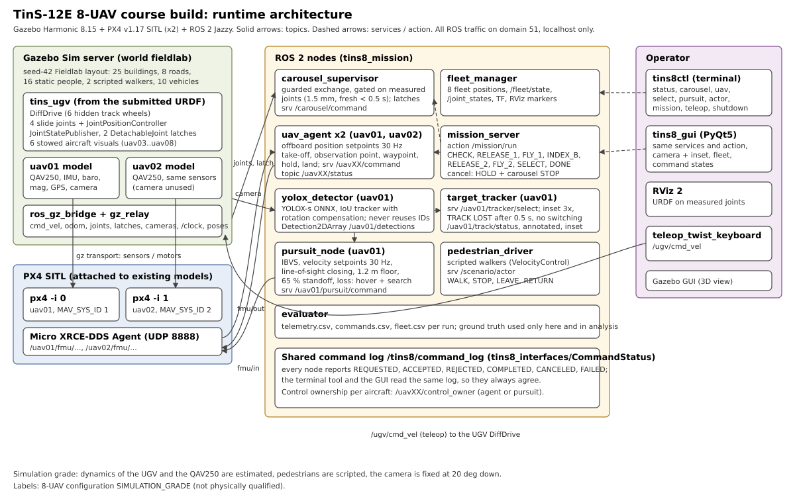

# TinS-12E UGV with an 8-UAV carousel: ROS 2 + Gazebo + PX4 course build

A ROS 2 Jazzy simulation of the TinS-12E tracked ground vehicle with its two-tray, eight-aircraft slide-exchange carousel. It runs in a native Gazebo copy of the Fieldlab city block.
Two QAV250 aircraft fly under their own PX4 SITL instances. The other six stay stowed on the carousel.

- UAV01 holds at an observation point. Its camera runs YOLOX person detection, and an operator-selected pedestrian is tracked in a magnified inset.
- UAV02 holds at a second point.
- A separate high-speed visual pursuit mode closes on the selected person.
- Everything runs from the terminal (`tins8ctl`) or from a GUI that uses the same ROS interfaces.

Status label: **8-UAV configuration, SIMULATION_GRADE**. Dynamics are estimated, the pedestrians are scripted, and nothing here is a physical qualification.



Full step-by-step guide: [docs/guide/build-guide.pdf](docs/guide/build-guide.pdf) (source: [docs/guide/build-guide.html](docs/guide/build-guide.html)).
Release archives: see the repository's *Releases* page, or build one with `scripts/make_release.sh`.

## Supported system

| item | tested |
|---|---|
| OS | Ubuntu 24.04 LTS (x86_64) |
| ROS 2 | Jazzy (desktop install from packages.ros.org) |
| Gazebo | Gazebo Sim 8.15.0 (Harmonic), installed by the ROS `ros-jazzy-ros-gz` packages |
| PX4 | PX4-Autopilot v1.17.0 (commit d6f12ad), SITL build |
| DDS bridge | Micro XRCE-DDS Agent v2.4.3, px4_msgs release/1.17 (commit 86d8239) |
| Machine | 16 GB RAM, 12 CPU threads, RTX 4050 laptop GPU. Gazebo camera rendering also works on the integrated GPU. |

A desktop session (X11) is needed for the Gazebo GUI, RViz and the operator GUI. Without a display, start with `gz_gui:=false rviz:=false gui:=false` and use the terminal tool; the cameras still render.

## Shortest path: fresh system to a running simulation

Prerequisite: ROS 2 Jazzy desktop is installed (`source /opt/ros/jazzy/setup.bash` works).

```bash
git clone https://github.com/mohd-Ali04/Multi-UAV-UGV-System-.git tins8_ws
cd tins8_ws
```

Install the dependencies. The apt step asks before using sudo. PX4 takes 15 to 30 minutes and about 3 GB. Everything except apt goes under `~/tins8_deps`.

```bash
scripts/setup_deps.sh all
```

If PX4, the agent and px4_msgs already exist somewhere else, skip that step and point the scripts at them instead:

```bash
cp scripts/local.env.example scripts/local.env   # then edit TINS8_DEPS in scripts/local.env
```

Build:

```bash
scripts/build.sh
```

Start everything with one command (Gazebo with GUI, agent, two PX4 instances, all nodes, RViz and the operator GUI):

```bash
scripts/sim_all.sh
```

Or start the same pieces in named terminals:

```bash
scripts/run_tabs.sh
```

With Terminator installed, this opens **one Terminator window** with three tabs split into named panes:
- **Simulation:** Gazebo, DDS agent, PX4 uav01, PX4 uav02.
- **ROS:** ROS nodes, RViz, GUI.
- **Operate:** Controls (type `tins8ctl` commands here) and Teleop UGV.

Without Terminator it falls back to gnome-terminal tabs, or tmux; force one with `scripts/run_tabs.sh terminator|gnome|tmux`. Use either `run_tabs.sh` or `sim_all.sh`, never both at once.

In every new terminal you open yourself, run this first:

```bash
source scripts/env.sh
```

No Git LFS is used; all meshes and the YOLOX model are ordinary files.

## What you should see after launch

- **Gazebo:** the Fieldlab block, with the TinS-12E at the start point (-28, -22). Two walkers move near the observation area.
- **`tins8ctl status`, about 30 s after launch:**

```text
FLEET  stowed=6 active_docked=2 airborne=0  (8 positions)
  uav01  tray_a/upper  ACTIVE_DOCKED independent PX4 model
  uav02  tray_b/lower  ACTIVE_DOCKED independent PX4 model
  uav03 ... uav08      STOWED        stowed visual
CAROUSEL  station=A_UPPER activity=IDLE fresh=True latched=['uav01', 'uav02']
UAV01  DOCKED   owner=agent   armed=False nav=AUTO_LOITER telemetry_age=0.02s ...
UAV02  DOCKED   owner=agent   armed=False nav=AUTO_LOITER telemetry_age=0.02s ...
```

So: eight fleet positions, two active aircraft (independent PX4 models) and six stowed. Each active aircraft appears exactly once, and when it leaves its dock its stowed slot shows empty.

- **PX4 panes:** each prints `[uxrce_dds_client] successfully created ...` lines (the agent is connected), `[tins8] re-applied 45 parameter overrides` and `Ready for takeoff!`.
- **Agent pane:** one banner line, then nothing; it is quiet while it runs.

## Example mission (terminal)

All commands go in the Controls pane (Operate tab), or in any terminal after `source ~/<workspace>/scripts/env.sh`.

1. Run the full two-aircraft mission (about 100 s). It releases uav01 and flies it to op1, does the guarded carousel exchange to B_UPPER, then releases uav02 and flies it to op2. Ctrl+C or `tins8ctl mission cancel` cancels it: the aircraft hold and the carousel stops.

   ```bash
   tins8ctl mission start --uav1 op1 --uav2 op2
   ```

2. Read the person IDs shown in UAV01's camera view (GUI or RViz), then select one. The inset centres on that ID. If the person leaves view, the inset shows `TRACK LOST`; it never switches to another person.

   ```bash
   tins8ctl status
   tins8ctl select 12
   ```

3. Send a walker out of view and back (scripted scenario control).

   ```bash
   tins8ctl actor person_12 leave
   tins8ctl actor person_12 return
   ```

4. Fly the separate inspection-waypoint demonstration with UAV02. UAV01 keeps holding.

   ```bash
   tins8ctl --wait uav uav02 goto wp_bus_stop
   ```

5. Run the high-speed visual pursuit of a selected person with UAV01, then stop it (the aircraft then holds where it is).

   ```bash
   tins8ctl pursuit uav01 start 12
   tins8ctl pursuit uav01 stop
   ```

6. Land.
   - Ground pad: implemented.
   - Landing on the UGV and re-stowage: not implemented; these requests are rejected with the reason.

   ```bash
   tins8ctl --wait uav uav01 land pad_west
   tins8ctl --wait uav uav02 land
   tins8ctl uav uav01 land ugv
   ```

7. Watch every request and its state (REQUESTED, ACCEPTED, REJECTED, COMPLETED, CANCELED, FAILED), as the GUI shows them:

   ```bash
   tins8ctl watch
   ```

Other controls:
- `tins8ctl carousel index-b|index-a|stop|release uav01`: carousel moves are gated on measured joint positions.
- `tins8ctl uav uav01 takeoff|obs op1|hold`: single-aircraft commands.
- `tins8ctl points`: lists the observation points, waypoints and pads.
- `tins8ctl teleop`: drive the UGV with the keyboard.

## Shutdown and relaunch

```bash
scripts/stop_all.sh
```

This stops only what this project started (PID files plus this workspace's Gazebo and PX4 processes), in reverse order, in about 30 s. Run `scripts/sim_all.sh` again to relaunch. PX4 parameters are reset on every start.

## Troubleshooting

| symptom | cause and fix |
|---|---|
| `PX4 SITL is not built at ...` | Run `scripts/setup_deps.sh px4`, or set `TINS8_DEPS` in `scripts/local.env`. |
| `UAV01 no status` or `telemetry_age=-1` | PX4 or the agent is not running yet. Check that both PX4 panes say `Ready for takeoff!` and show `successfully created` lines. |
| `REJECTED: dock latch is attached; release it with the carousel first` | Intended interlock. Use `tins8ctl carousel release uav01`, or run the mission. |
| `REJECTED: uav02_dock is not accessible at station A_UPPER` | Intended interlock. Index the carousel to B_UPPER first. |
| carousel `FAILED no measured progress (stall)` | Something blocks a tray. Clear it, then send the same index command again to resume. |
| nothing appears in `ros2 topic list` | Source `scripts/env.sh`. The project uses `ROS_DOMAIN_ID=51`, localhost-only discovery and `GZ_PARTITION=tins8`, so it never mixes with other simulations. |
| slow simulation (real-time factor well below 0.5) | Close other GPU or CPU-heavy programs. Start with `rviz:=false`. The YOLOX detector uses about 4 CPU cores. |

## Repository layout

```text
src/tins_description   submitted TinS-12E URDF, meshes, guarded-exchange register (unchanged copy)
src/tins8_interfaces   messages, services, RunMission action
src/tins8_gazebo       Fieldlab world, UGV model generated from the URDF, QAV250 models, assets, scenario.yaml
src/tins8_mission      all nodes, tins8ctl, the GUI, YOLOX model, unit tests
src/tins8_bringup      launch files, bridge map, PX4 parameter overrides, RViz config
scripts/               setup, build, start/stop, tab launcher, release, analysis and test helpers
docs/                  build guide (PDF + HTML source), figures, recorded results
```

Results from the recorded runs are in [docs/results](docs/results): the minimal-world flight, the mission with tracking and isolation, cancellation and landing, pursuit, and the world conversion check.
Credits and licences: [THIRD_PARTY_CREDITS.md](THIRD_PARTY_CREDITS.md). Project code is Apache-2.0 ([LICENSE](LICENSE)).
